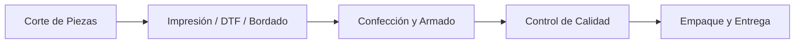

# 📖 Manual de Usuario — AbbySoft Textil
### Sistema de Gestión Textil bajo Pedido, Trazabilidad QR y Control Financiero Bimonetario
**Versión:** 1.0 — Adaptación Oficial para el Mercado Venezolano  
**Empresa:** AbbySoft Textil  
**Moneda Base:** Dólar Estadounidense ($ USD) | **Moneda Secundaria:** Bolívares (Bs.)  
**Tasa de Referencia:** Banco Central de Venezuela (BCV)  

---

## 📑 Tabla de Contenidos

1. [Introducción y Filosofía del Sistema](#1-introducción-y-filosofía-del-sistema)
2. [Acceso al Sistema y Roles de Usuario](#2-acceso-al-sistema-y-roles-de-usuario)
3. [Barra Superior: Monitor de Tasa BCV y Conversión Dual](#3-barra-superior-monitor-de-tasa-bcv-y-conversión-dual)
4. [Módulo 1: Dashboard de Control y Alertas](#4-módulo-1-dashboard-de-control-y-alertas)
5. [Módulo 2: Clientes y Control de Cartera](#5-módulo-2-clientes-y-control-de-cartera)
6. [Módulo 3: Catálogo de Productos y SKUs Inteligentes](#6-módulo-3-catálogo-de-productos-y-skus-inteligentes)
7. [Módulo 4: Ventas y Pedidos (Regla de Anticipo y Trazabilidad)](#7-módulo-4-ventas-y-pedidos-regla-de-anticipo-y-trazabilidad)
8. [Módulo 5: Producción Textil por Etapas (Kanban y Escáner QR)](#8-módulo-5-producción-textil-por-etapas-kanban-y-escáner-qr)
9. [Módulo 6: Personal y Nómina por Producción](#9-módulo-6-personal-y-nómina-por-producción)
10. [Módulo 7: Portal del Trabajador (Acceso Móvil en Taller)](#10-módulo-7-portal-del-trabajador-acceso-móvil-en-taller)
11. [Módulo 8: Módulo de Caja, Tesorería y Métodos Venezolanos](#11-módulo-8-módulo-de-caja-tesorería-y-métodos-venezolanos)
12. [Módulo 9: Reportes, Rentabilidad y Exportación CSV](#12-módulo-9-reportes-rentabilidad-y-exportación-csv)
13. [Preguntas Frecuentes y Solución de Problemas](#13-preguntas-frecuentes-y-solución-de-problemas)
14. [Guía de Arranque y Mantenimiento Técnico](#14-guía-de-arranque-y-mantenimiento-técnico)

---

## 1. Introducción y Filosofía del Sistema

**AbbySoft Textil** es una plataforma integral diseñada específicamente para talleres de confección y fábricas textiles bajo pedido en **Venezuela** (ropa deportiva, dotación ejecutiva, camisas, pantalones, conjuntos de damas/caballeros/niños y bolsos).

El sistema resuelve los cuatro desafíos críticos del taller textil:
1. **Trazabilidad Absoluta por Prenda:** Cada prenda producida cuenta con un código SKU único por modelo, color y talla, y un **Código de Rastreo Único (QR)** que evita confusiones durante el corte, estampado y costura.
2. **Cero Riesgo Financiero (Regla del Anticipo Mínimo del 30%):** Ningún pedido entra a corte ni genera gasto de tela hasta que el cliente abone como mínimo el 30% del total.
3. **Economía Bimonetaria de Venezuela:** La contabilidad y base de datos operan en **Dólares ($ USD)** para proteger el valor financiero, mientras que el cobro y facturación permiten **Bolívares (Bs.)** sincronizados en tiempo real con la tasa oficial del **Banco Central de Venezuela (BCV)**.
4. **Liquidación Automática por Pieza:** Calcula automáticamente la nómina de costureros, cortadores y técnicos de estampado por cada prenda efectivamente terminada.

---

## 2. Acceso al Sistema y Roles de Usuario

### 2.1. Pantalla de Inicio de Sesión (`/login`)
Para ingresar al sistema:
1. Abra su navegador web e ingrese a `http://localhost:5173/login` (o la dirección del servidor de su red local).
2. Introduzca su **Correo Electrónico** y **Contraseña**.
3. Presione el botón **"Iniciar Sesión"**.

> [!NOTE]
> **Usuario Administrador Predeterminado:**  
> - **Correo:** `admin@textilapp.com`  
> - **Contraseña:** `admin123`

---

### 2.2. Perfiles y Permisos (RBAC)

El sistema cuenta con tres niveles de acceso claramente definidos:

| Rol | Módulos Accesibles | Descripción |
|---|---|---|
| **Superusuario / Administrador** | **Todos** (Dashboard, Clientes, Catálogo, Pedidos, Producción, Trabajadores, Nómina, Tesorería, Reportes, Tasa BCV) | Control gerencial absoluto de la empresa textil. |
| **Vendedor** | Clientes, Ventas & Pedidos, Producción (solo lectura), Tesorería (registro de cobros) | Registro de clientes, toma de pedidos y recepción de abonos de sus clientes. |
| **Trabajador (Operario de Taller)** | **Portal del Trabajador Exclusivo** (`/portal-trabajador`) | Entorno seguro y simplificado para operarios. Permite escanear prendas QR y ver sus ganancias acumuladas sin ver precios de venta al público ni datos de clientes. |

---

## 3. Barra Superior: Monitor de Tasa BCV y Conversión Dual

En la parte superior de todas las pantallas administrativas se encuentra el **Ticker Financiero de AbbySoft**:

```
[🏛️ Tasa BCV: 1 USD = 881.07 Bs.  |  Fuente: bcv_dolarapi  |  🔄 Sincronizar  |  ✏️ Fijar Manual]
```

### Funcionalidades:
1. **Sincronización Automática:** El sistema consulta periódicamente el servicio oficial del BCV y mantiene la tasa actualizada.
2. **Botón Sincronizar (🔄):** Fuerza una actualización inmediata de la tasa oficial del día.
3. **Botón Fijar Manual (✏️):** Permite al administrador ingresar una tasa acordada o personalizada si se pierde temporalmente la conexión a internet.
4. **Visualización Dual Automática:** Todos los montos del sistema se expresan simultáneamente en `$ USD` y `Bs.` (por ejemplo: `$22.00 USD (Bs. 19,383.46)`).

---

## 4. Módulo 1: Dashboard de Control y Alertas

El **Dashboard** (`/dashboard`) proporciona la vista de pájaro de la fábrica textil en tiempo real:

### 4.1. Alertas Críticas Automáticas
Aparecen en cajas rojas en la cabecera:
* **Pedidos en Borrador Retenidos:** Avisa cuántos pedidos están en espera de completar el 30% de anticipo para poder cortar la tela.
* **Clientes con Cupo Superado:** Alerta si algún cliente debe más de lo autorizado.

### 4.2. Tarjetas de KPIs Principales
* **Pedidos Nuevos Hoy:** Pedidos tomados en el día.
* **En Producción Activa:** Prendas pasando actualmente por Corte, Impresión o Confección.
* **Pendientes de Cobro:** Pedidos entregados o en confección con saldos a crédito.
* **Entregados (Mes):** Total de prendas despachadas a satisfacción en el mes calendario.

### 4.3. Métricas Financieras Diarias y Mensuales
* **Recaudo Hoy:** Total de dólares y bolívares que ingresaron a caja en la jornada.
* **Recaudo del Mes:** Acumulado financiero cobrado en el mes en curso.
* **Cartera Total:** Suma de todas las deudas pendientes de clientes.

---

## 5. Módulo 2: Clientes y Control de Cartera

En este módulo (`/clientes`) se gestiona la cartera de clientes mayoristas, tiendas y corporaciones.

### 5.1. Registrar un Nuevo Cliente
1. Haga clic en **"+ Nuevo Cliente"**.
2. Complete los campos con formato venezolano:
   * **Nombre o Razón Social:** Ej. *Distribuidora Textil El Ávila C.A.*
   * **Documento (RIF / C.I.):** Ej. *J-40123456-7* o *V-14556789*.
   * **Teléfono / WhatsApp:** Prefijo venezolano (+58 412, +58 414, +58 424, etc.).
   * **Dirección de Entrega:** Ej. *Av. Francisco de Miranda, Torre Centro, Piso 4, Chacao, Caracas*.
   * **Cupo de Crédito Máximo ($ USD):** Límite máximo en dólares que la empresa le financia a este cliente (ej. `$2,000.00`).
3. Haga clic en **"Registrar Cliente"**.

### 5.2. Monitoreo de Disponibilidad de Crédito
Cada fila de cliente cuenta con una barra visual interactiva:
* **Verde (0% - 75%):** Crédito disponible holgado.
* **Ámbar (75% - 99%):** Próximo al límite de crédito.
* **Rojo (100%+):** **Cupo Superado**. El sistema no permitirá crear nuevos pedidos a crédito a menos que el cliente abone a su saldo pendiente.

---

## 6. Módulo 3: Catálogo de Productos y SKUs Inteligentes

En este módulo (`/catalogo`) se definen los modelos de prendas que fabrica el taller.

### 6.1. Crear un Producto Base
1. Haga clic en **"+ Nuevo Producto"**.
2. Defina:
   * **Código Base:** Ej. `CAM-OXF` (Camisa Oxford), `CONJ-DEP` (Conjunto Deportivo).
   * **Nombre:** Ej. *Camisa Oxford Clásica Manga Larga*.
   * **Tipo de Prenda:** Camisa, Conjunto Dama, Pantalón, Bolso, etc.
   * **Precio Base ($ USD):** Precio de venta al público en dólares (ej. `$22.00`).
   * **Descripción:** Composición de la tela, instrucciones de lavado y corte.

### 6.2. Generar Variantes y SKUs Únicos
Para evitar errores de confección, cada combinación de color y talla tiene un SKU único:
1. En la tarjeta del producto, haga clic en **"Gestionar Variantes"**.
2. Seleccione el **Color** (ej. *Blanco*) y la **Talla** (ej. *M*).
3. Ingrese el **Stock Inicial** (si aplica stock para entrega inmediata).
4. El sistema autogenerará el SKU: `CAMOXF-BLA-M`.
5. Guarde la variante.

---

## 7. Módulo 4: Ventas y Pedidos (Regla de Anticipo y Trazabilidad)

El módulo de Pedidos (`/pedidos`) es el corazón comercial y operativo de AbbySoft Textil.

### 7.1. Crear un Pedido Paso a Paso
1. Haga clic en **"+ Nuevo Pedido"**.
2. **Seleccionar Cliente:** Al elegir el cliente, se mostrará en pantalla su Cupo Máximo, Saldo Deudor y Crédito Disponible.
3. **Agregar Líneas de Producción:**
   * Seleccione el producto y variante (ej. *Camisa Oxford - Blanco - M*).
   * Ingrese la cantidad de prendas (ej. *50 unidades*).
   * El sistema calcula el subtotal automáticamente en dólares y bolívares.
4. **Indicar el Anticipo:**
   * Ingrese el monto en dólares que el cliente paga de entrada.

### 7.2. La Regla de Oro del 30%
El sistema aplica control preventivo estricto:
* **Si el anticipo es MENOR al 30% del total:**
  * El pedido queda marcado automáticamente en estado **`Borrador (Falta Ant)`**.
  * **BLOQUEO:** El pedido **no genera órdenes de corte ni aparece en el tablero de producción de los operarios**.
  * Se notifica en el Dashboard como pedido en riesgo.
* **Si el anticipo es IGUAL o MAYOR al 30%:**
  * El pedido pasa automáticamente a **`Confirmado`**.
  * Se generan las órdenes de producción y los **Códigos de Rastreo Únicos QR**.

### 7.3. Control de Bloqueo por Crédito
Si el saldo que queda debiendo el cliente excede su cupo de crédito disponible, el formulario se bloquea y muestra:
> 🚫 **BLOQUEO POR CUPO DE CRÉDITO:** El saldo resultante supera el cupo asignado. Aumente el anticipo para permitir la creación del pedido.

### 7.4. Códigos de Rastreo de Producción
Cada línea de pedido genera un código único irrevocable, por ejemplo:
`RAS-PED1-CAMOXF-BLA-S-01`
Este código acompaña a las piezas desde que se corta la tela hasta que se entrega empaquetada al cliente.

---

## 8. Módulo 5: Producción Textil por Etapas (Kanban y Escáner QR)

En `/produccion`, los jefes de taller y supervisores gestionan el avance físico de las prendas mediante un tablero Kanban secuencial.

### 8.1. Flujo Secuencial Obligatorio



1. **Etapa 1: Corte de Piezas**
   * Se asigna el lote al cortador responsable.
   * Se registra el número de piezas y el costo de corte acordado (ej. `$0.50 USD` por pieza).
   * Al hacer clic en **"Terminar Corte"**, el lote queda listo para estampado.
2. **Etapa 2: Impresión / Estampado (si aplica)**
   * Admite técnicas: **DTF**, **Serigrafía**, **Sublimación**, **Bordado**, **Vinil Textil**.
   * Se asigna al técnico de estampación indicando si es *Antes de Costura* (piezas desarmadas) o *Prenda Armada*.
   * Al finalizar, pasa a confección.
3. **Etapa 3: Confección**
   * Se entrega el lote con sus avíos (hilos, botones, cierres) al costurero/operador.
   * Al hacer clic en **"Terminar Confección"**, la orden queda concluida.

### 8.2. Escáner Rápido de Producción por Código de Barras / QR
En la parte superior del tablero Kanban se encuentra la barra de escaneo rápido:
1. Enfoque el código de barras/QR de la etiqueta de la prenda con el lector óptico o cámara.
2. Seleccione el operario que realizó el trabajo.
3. Presione Enter o escanee:
   * La prenda avanza automáticamente a la siguiente etapa.
   * El sistema calcula y acredita en tiempo real la ganancia a la nómina del trabajador.
   * Muestra un mensaje verde de éxito: `¡Confección Registrada! (+$2.50 USD acreditados a Carlos)`.

---

## 9. Módulo 6: Personal y Nómina por Producción

En `/trabajadores` se gestiona el equipo humano del taller y la liquidación automática de haberes.

### 9.1. Modalidades de Pago de Trabajadores
* **Por Producción (Destajo puro):** El operario no tiene sueldo base; gana exactamente lo que produce según las piezas cortadas, confeccionadas o estampadas.
* **Sueldo Fijo:** Gana un salario mensual o quincenal predeterminado en dólares.
* **Mixto:** Tiene un sueldo base garantizado más un pago adicional por cada pieza terminada.

### 9.2. Liquidación Automática de Nómina en 3 Clics
1. Diríjase a la pestaña **"Liquidación de Nómina por Producción"**.
2. Seleccione el rango de fechas a liquidar:
   * **Periodo Inicio:** Ej. `2026-10-15`
   * **Periodo Fin:** Ej. `2026-10-22`
3. Haga clic en **"Calcular Nómina del Periodo"**:
   * El sistema busca todas las órdenes terminadas en corte, impresión y confección en esas fechas.
   * Desglosa por cada trabajador: Piezas producidas, Monto de producción, Sueldo base y **Total Neto a Pagar ($ USD)**.
4. Para pagar: Presione el botón **"Pagar"** al lado de cada operario. Quedará archivado el recibo digital con fecha y hora exacta.

---

## 10. Módulo 7: Portal del Trabajador (Acceso Móvil en Taller)

Diseñado para funcionar en teléfonos móviles de los operarios o tablets instaladas en cada mesa del taller (`/portal-trabajador`).

### 10.1. Características del Portal:
* **Entorno Aislado y Seguro:** El operario inicia sesión con su usuario y contraseña; no tiene acceso a precios de venta, ganancias de la empresa ni listado de clientes.
* **Contadores en Vivo:**
  * **Hoy:** Cantidad de prendas procesadas hoy y dólares ganados en la jornada.
  * **Esta Semana:** Prendas y acumulación semanal.
  * **Este Mes:** Proyección estimada del mes en curso.
* **Escáner Integrado:** El operario puede escanear prendas directamente desde su celular para registrar su producción en el instante.
* **Mis Últimos Pagos:** Historial de nóminas pagadas y pendientes con sus fechas de liquidación.

---

## 11. Módulo 8: Módulo de Caja, Tesorería y Métodos Venezolanos

Ubicado en `/tesoreria`, es el módulo financiero adaptado 100% al comercio venezolano.

### 11.1. Métodos de Pago Nacionales e Internacionales Soportados
1. **Pago Móvil (C2P / P2P):** Con número de teléfono, banco nacional y número de referencia.
2. **Efectivo Dólares ($ USD):** Recepción de divisas físicas.
3. **Efectivo Bolívares (Bs.):** Efectivo nacional a tasa BCV.
4. **Transferencia Bancaria Bs.:** Banesco, Mercantil, Banco de Venezuela (BDV), BBVA Provincial, BNC, Bancamiga, Banplus, etc.
5. **Punto de Venta / Biopago:** Tarjetas de débito nacional en bolívares.
6. **Zelle:** Pagos electrónicos en dólares desde cuentas americanas.
7. **Binance Pay (USDT):** Criptoactivos estables para clientes internacionales o tecnológicos.
8. **Otro (Zinli, Wally, etc.).**

### 11.2. Registrar un Pago a un Pedido
1. En la pestaña **"Abonar a Pedido"**, seleccione el pedido.
2. Elija la **Moneda de Pago** que entrega el cliente:
   * Si entrega **Dólares ($ USD)**: Ingrese el monto en USD; el sistema mostrará la equivalencia en Bs.
   * Si entrega **Bolívares (Bs.)**: Ingrese los bolívares entregados; el sistema calcula automáticamente cuántos dólares amortiza a la tasa BCV del día.
3. Seleccione el método de pago (ej. *Pago Móvil*).
4. Seleccione el banco emisor o receptor (ej. *Banco de Venezuela BDV*).
5. Ingrese el número de referencia y teléfono del comprobante.
6. Haga clic en **"Registrar Pago"**:
   * El saldo del pedido se reduce inmediatamente.
   * Si el pedido estaba en `Borrador` y con este pago alcanza el 30%, **se desbloquea automáticamente a producción**.

### 11.3. Arqueo y Cierre Diario de Caja
La pestaña **"Arqueo de Caja Diario"** consolida todos los cobros del día:
* Total recaudado en **$ USD**.
* Total recaudado en **Bolívares (Bs.)**.
* Desglose exacto por método: Cuánto entró por Pago Móvil, cuánto en Efectivo USD, cuánto por Punto de Venta y cuánto por Zelle/Binance.
* Permite cuadrar la caja física y las cuentas bancarias al finalizar la jornada.

---

## 12. Módulo 9: Reportes, Rentabilidad y Exportación CSV

Ubicado en `/reportes`, permite a la gerencia tomar decisiones estratégicas basadas en datos reales.

### 12.1. Tipos de Reportes Disponibles
1. **Reporte de Ventas:**
   * Ventas totales por período (Desde / Hasta).
   * Facturación y saldo pendiente desglosado por Cliente.
   * Prendas más vendidas por modelo, color y talla (SKU).
   * Rendimiento por vendedor.
2. **Reporte de Producción:**
   * Total de prendas cortadas, estampadas y confeccionadas.
   * Rendimiento y costo generado por cada operario.
   * Producción por técnica de estampado (DTF, Serigrafía, Sublimación).
3. **Reporte de Rentabilidad Real por Pedido:**
   * Compara: **Precio Facturado al Cliente** vs. **Costo Real de Producción** (mano de obra de corte, costura y estampación).
   * Muestra la **Ganancia Bruta en $ USD** y el **Margen de Ganancia Porcentual (%)**.
   * Identifica pedidos con margen bajo (< 20%) o margen saludable (> 40%).
4. **Reporte de Morosidad y Cuentas por Cobrar:**
   * Listado de clientes con facturas pendientes.
   * Semáforo de antigüedad: Días de mora (30, 60, 90+ días).
   * Clasificación de riesgo de crédito: *Normal*, *Alerta* o *Bloqueado*.

### 12.2. Exportar a Excel / CSV
En cualquiera de los reportes, presione el botón verde **"Exportar CSV"** en la esquina superior derecha. Se descargará inmediatamente un archivo `.csv` listo para abrir en Microsoft Excel o Google Sheets.

---

## 13. Preguntas Frecuentes y Solución de Problemas

### P: ¿Por qué un pedido que acabo de crear no aparece en el taller de corte?
> **R:** Verifique el porcentaje de anticipo. Si el cliente abonó menos del 30% del total, el pedido queda retenido en estado **Borrador**. Vaya a **Tesorería**, registre el pago faltante del anticipo y el pedido pasará automáticamente a **Confirmado**, enviándose de inmediato al taller.

### P: Se cayó la conexión a internet y no carga la tasa del BCV. ¿Se puede seguir facturando?
> **R:** Sí. El sistema conserva en caché la última tasa oficial válida. Además, cualquier administrador puede hacer clic en **"✏️ Fijar Manual"** en la barra superior e ingresar manualmente la tasa del día para continuar operando sin interrupción.

### P: ¿Cómo creo un usuario para un costurero que solo use el celular?
> **R:** Vaya a administración de usuarios, cree el usuario con el rol **`trabajador`** y asígnele una contraseña. Cuando ese trabajador inicie sesión, el sistema detectará su rol y lo enviará directamente al **Portal del Trabajador** (`/portal-trabajador`), bloqueándole el acceso a finanzas, precios y clientes.

### P: Un cliente pagó en bolívares por Pago Móvil y en dólares en efectivo. ¿Cómo lo registro?
> **R:** Registre dos pagos separados para el mismo pedido en **Tesorería**:
> 1. Primero registre el pago en moneda **BS** con método *Pago Móvil*, banco y referencia.
> 2. Luego registre el segundo pago en moneda **USD** con método *Efectivo USD*.  
> El sistema sumará ambos montos y descontará el equivalente exacto en dólares del saldo del pedido.

---

## 14. Guía de Arranque y Mantenimiento Técnico

### 14.1. Iniciar los Servicios en la Computadora Principal (Servidor Local)

Abra dos terminales de PowerShell en `c:\Users\mlk\Documents\abby_textil`:

**Terminal 1 (Backend - FastAPI):**
```powershell
cd backend
.\.venv\Scripts\activate
uvicorn app.main:app --reload --host 0.0.0.0 --port 8000
```

**Terminal 2 (Frontend - Vite React):**
```powershell
cd frontend
npm run dev -- --host
```

> [!TIP]
> Al agregar `--host`, cualquier teléfono, tablet o computadora conectada a la misma red Wi-Fi del taller podrá ingresar colocando la dirección IP local de la computadora principal (ejemplo: `http://192.168.1.50:5173`).

---

### 14.2. Respaldar la Base de Datos PostgreSQL
Para resguardar la información de clientes, pedidos, pagos y nóminas, ejecute periódicamente:

```powershell
pg_dump -U postgres -d textil_app -F c -b -v -f "respaldo_textil_$(Get-Date -Format 'yyyyMMdd').backup"
```

Para restaurar en caso de contingencia:
```powershell
pg_restore -U postgres -d textil_app -v "respaldo_textil_YYYYMMDD.backup"
```

---

*Manual elaborado y certificado para **AbbySoft Textil** — Sistema de Producción Textil bajo Pedido.*  
*Caracas / Valencia, Venezuela — 2026.*
